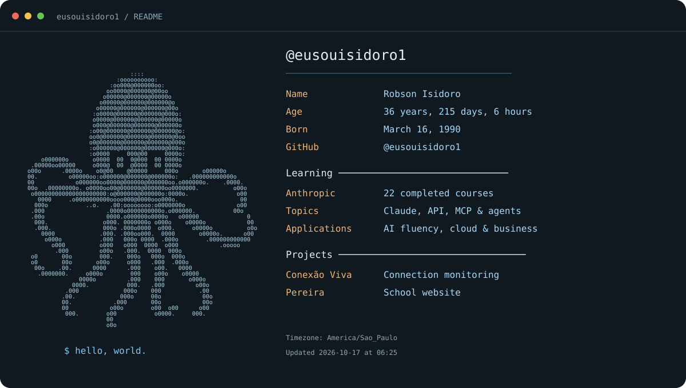

## Learning with Anthropic

**22 completed courses at Anthropic Academy**, covering Claude, AI development, MCP, agents and practical AI applications.

<strong>Claude & tools — 5 courses</strong>

- Claude 101
- Claude Code 101
- Claude Platform 101
- Introduction to Claude Cowork
- Claude Code in Action

<strong>Development, MCP & agents — 5 courses</strong>

- Building with the Claude API
- Introduction to Model Context Protocol
- Model Context Protocol: Advanced Topics
- Introduction to agent skills
- Introduction to subagents

<strong>AI fluency & applications — 9 courses</strong>

- AI Fluency: Framework & Foundations
- AI Fluency for educators
- AI Fluency for students
- Teaching AI Fluency
- AI Fluency for nonprofits
- AI Capabilities and Limitations
- AI Fluency for Small Businesses
- AI Fluency for Builders
- AI Fluency for Creative Work

<strong>Cloud & enterprise adoption — 3 courses</strong>

- Claude with Amazon Bedrock
- Claude on Google Cloud
- Deploying Claude Enterprise with Confidence: The five decisions that shape your rollout

## Projects

- [Conexão Viva](https://github.com/eusouisidoro1/conexao-viva) — Windows connection monitor with latency, packet loss, route diagnostics, outage history and alerts. Built with Python, PySide6 and SQLite.
- [Complexo Escolar Pereira](https://github.com/eusouisidoro1/complexo-escolar-pereira) — School website.
